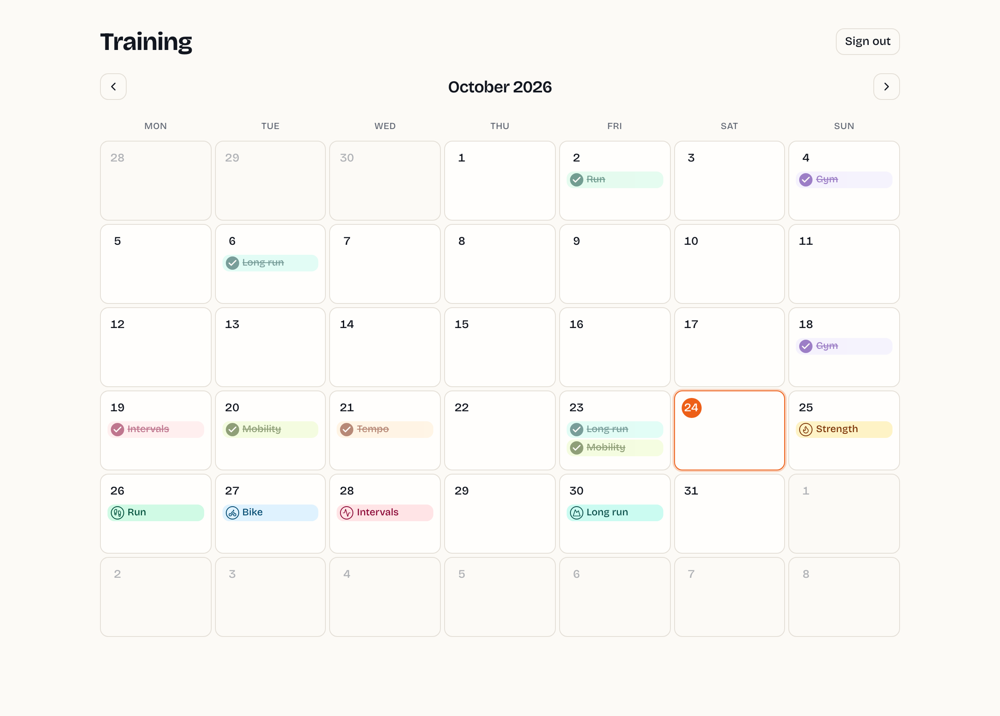
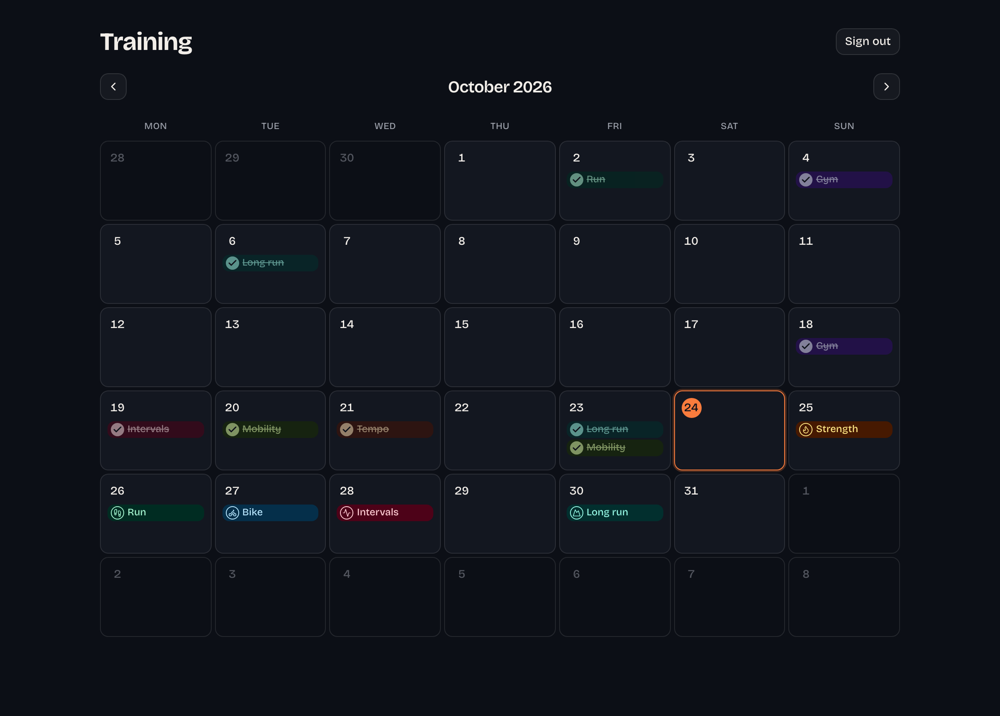
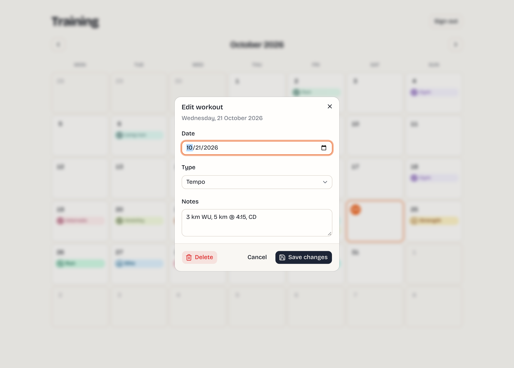
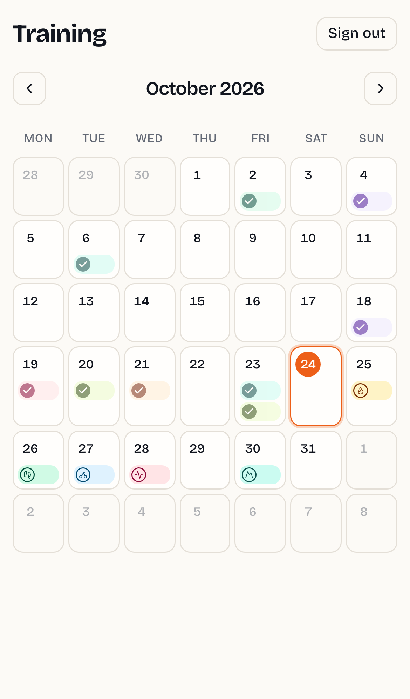
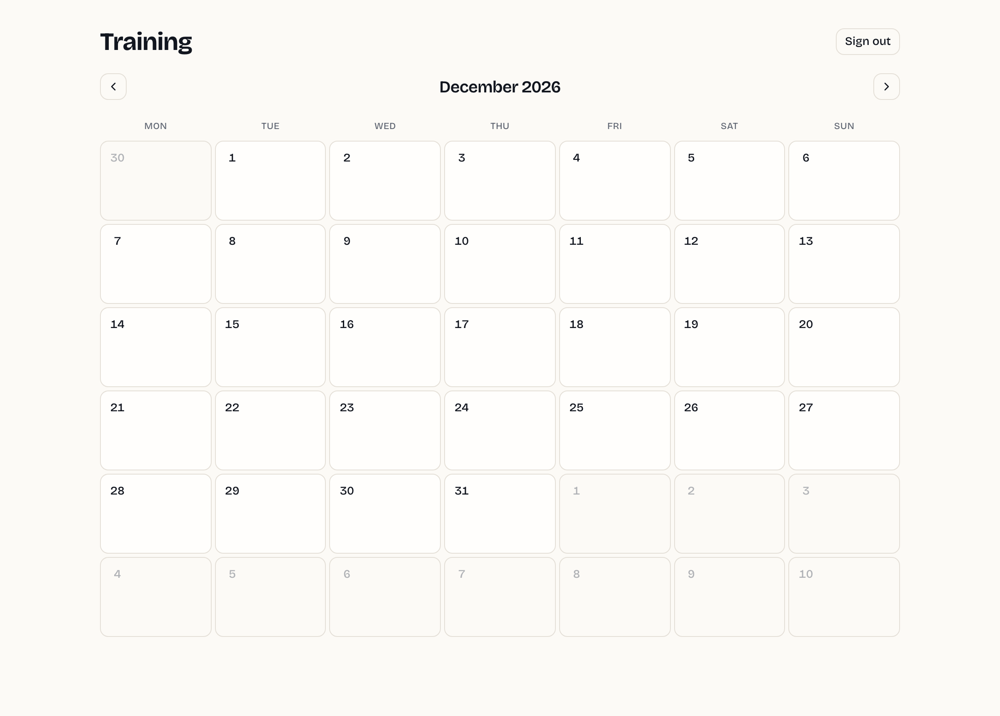
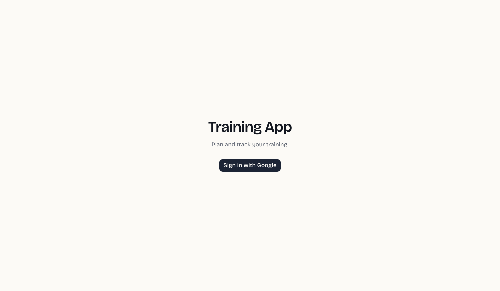

# Training App

[](https://github.com/sir-hector/training-app/actions/workflows/ci.yml)
[](https://github.com/sir-hector/training-app/actions/workflows/deploy.yml)
[](https://github.com/sir-hector/training-app/actions/workflows/neon-branch.yml)

A private, calendar-based training planner. Plan workouts on a month grid, tick them off as you do them, and check your plan from any device.

**Try it live: [training-app-hector.fly.dev](https://training-app-hector.fly.dev)** (sign in with Google; your calendar is private to your account).



| Dark mode follows your OS                        | Editing a workout                                | On a phone                                      |
| ------------------------------------------------ | ------------------------------------------------ | ----------------------------------------------- |
|  |  |  |

<details>
<summary>Empty month and sign-in screen</summary>




</details>

## Features

- **Month calendar** with Monday-first weeks, today highlighted, and prev/next navigation (`/app?month=YYYY-MM`, so months are bookmarkable)
- **Add workouts** to any day: nine types (gym, run, bike, intervals, tempo, long run, strength, mobility, other) plus free-text notes
- **Mark done** straight from the calendar; done workouts fade and strike through, and the completion time is recorded
- **Edit and delete**, including moving a workout to another date; delete asks for confirmation
- **Optimistic UI**: changes appear instantly and reconcile with the server
- **Google sign-in** with database sessions; every query is scoped to the signed-in user

See [`PRD.md`](./PRD.md) for the full design record and the reasoning behind each choice.

## Stack

| Layer         | Choice                                                                           |
| ------------- | -------------------------------------------------------------------------------- |
| Framework     | **Next.js 16** (App Router, Server Actions) + **React 19** + **TypeScript**      |
| UI            | **Tailwind CSS v4** + **shadcn/ui** on Base UI; **Bricolage Grotesque** typeface |
| Auth          | **Auth.js v5**, Google OAuth, database sessions                                  |
| Database      | **Neon Postgres** (serverless) + **Drizzle ORM**, migrations checked in          |
| Testing       | **Vitest** (unit + integration against a real Neon branch), **Playwright** (e2e) |
| Hosting       | **Fly.io** (Docker, standalone Next.js output)                                   |
| CI/CD         | **GitHub Actions**: checks on every PR, a Neon branch per PR, deploy on merge    |
| Observability | **Sentry**                                                                       |

### How the code is organised

- **`src/lib/calendar-grid`**: pure function that builds the 6×7 month grid. No I/O, fully unit-tested.
- **`src/lib/workout-types`**: the single source of truth for workout types: DB enum, validation, labels, colors and icons.
- **`src/lib/workouts-repo`**: the only module that touches the `workouts` table. **Every method takes `userId` first**, so no code path can read or change another user's data. Integration tests guard this.
- **`src/app/app/actions.ts`**: server actions. Each resolves `auth()` first, validates with Zod, then calls the repo.
- **`src/components/calendar`**: `MonthGrid`, `DayCell`, `WorkoutCard`, `WorkoutDialog`. Display and interaction only.

## Local development

Requirements: **Node.js 22**, **npm 10**, a free [Neon](https://neon.tech) project, and a Google OAuth client.

```bash
npm install
cp .env.example .env.local   # fill it in, see below
npm run db:migrate           # create tables on your Neon branch
npm run dev                  # http://localhost:3000
```

### One-time setup

1. **Neon**: create a project, then copy the **pooled** connection string for the `neondb_owner` role into `DATABASE_URL`. (The Data API's `authenticator` role can't create tables.) A personal branch like `dev/<you>` keeps local data separate from production.
2. **Google OAuth**: in Google Cloud Console create an OAuth 2.0 Client ID (Web application) with the redirect URI `http://localhost:3000/api/auth/callback/google`. Put the ID and secret in `AUTH_GOOGLE_ID` / `AUTH_GOOGLE_SECRET`.
3. **Auth secret**: `npx auth secret` writes a random `AUTH_SECRET` into `.env.local`.

### Database changes

Edit `src/db/schema.ts`, then:

```bash
npm run db:generate   # writes a new SQL migration under drizzle/
npm run db:migrate    # applies pending migrations to DATABASE_URL
npm run db:studio     # browse the DB in Drizzle Studio
```

Commit the generated migration. CI applies it to a throwaway Neon branch for every PR, and the deploy workflow applies it to production before the new image goes live.

### Scripts

| Command                    | What it does                                                   |
| -------------------------- | -------------------------------------------------------------- |
| `npm run dev`              | Next.js dev server (Turbopack)                                 |
| `npm run build` / `start`  | Production build / serve it                                    |
| `npm run typecheck`        | `tsc --noEmit`                                                 |
| `npm run lint`             | ESLint                                                         |
| `npm run format[:check]`   | Prettier write / verify                                        |
| `npm test`                 | Vitest unit tests (pure modules, no DB)                        |
| `npm run test:integration` | Vitest integration tests against `DATABASE_URL`                |
| `npm run test:e2e`         | Playwright golden path (desktop + phone) against a running app |
| `npm run screenshots`      | Regenerate the README screenshots with a throwaway demo user   |
| `npm run db:generate`      | Drizzle: generate a migration from the schema                  |
| `npm run db:migrate`       | Drizzle: apply migrations to `DATABASE_URL`                    |
| `npm run db:studio`        | Drizzle Studio                                                 |

## Testing

- **Unit** (`npm test`): the calendar grid: padding days, Monday-start months, leap years, year boundaries.
- **Integration** (`npm run test:integration`): `workouts-repo` against a real Postgres. Round-trips, done/undone timestamps, and **cross-user isolation**: user A can never list, update, toggle or delete user B's workouts.
- **End-to-end** (`npm run test:e2e`): Playwright drives the golden path on desktop and a phone viewport. It opens the calendar, adds a workout through the dialog, marks it done, reloads, and checks it's still done. It also checks that anonymous visitors are redirected.

  Google's consent screen can't run in CI, so the test creates a user and a database session directly and sets the session cookie. That's exactly the state Auth.js produces after a real Google callback, so no test-only code ships to production. See `e2e/test-user.ts`.

Every PR runs all three: unit tests in `ci.yml`, and integration + e2e in `neon-branch.yml` against a fresh Neon branch (`preview/pr-<n>`) that is deleted when the PR closes.

## Deployment

Prod deploys are triggered by pushes to `main` via [`.github/workflows/deploy.yml`](./.github/workflows/deploy.yml). The workflow uses `flyctl deploy --remote-only`, so no Docker daemon is needed on GitHub runners.

### GitHub Actions secrets required for deploy

Set these under **Settings → Secrets and variables → Actions** on the repo:

| Secret                   | Where to get it                                                          |
| ------------------------ | ------------------------------------------------------------------------ |
| `FLY_API_TOKEN`          | `flyctl auth token` after `flyctl auth login`                            |
| `NEXT_PUBLIC_SENTRY_DSN` | Sentry → Settings → Projects → training-app → Client Keys (DSN)          |
| `SENTRY_AUTH_TOKEN`      | Sentry → Settings → Auth Tokens (scopes: `project:releases`, `org:read`) |
| `SENTRY_ORG`             | Your Sentry org slug                                                     |
| `SENTRY_PROJECT`         | `training-app`                                                           |
| `DATABASE_URL`           | Neon → `main` branch → pooled connection string (used to migrate prod)   |
| `NEON_API_KEY`           | Neon → Account settings → API keys (used for per-PR branches)            |

And one **repository variable** (not secret): `NEON_PROJECT_ID` — Neon → project → Settings → General.

### Fly.io runtime secrets

The app reads these at runtime (not build time), so set them once with `flyctl secrets set`:

```bash
flyctl secrets set -a training-app-hector \
  DATABASE_URL=<neon main pooled url> \
  AUTH_SECRET=<openssl rand -base64 32> \
  AUTH_GOOGLE_ID=<google client id> \
  AUTH_GOOGLE_SECRET=<google client secret> \
  AUTH_TRUST_HOST=true
```

`AUTH_URL` is not a secret and lives in `fly.toml` under `[env]`.

The Google OAuth client also needs `https://training-app-hector.fly.dev/api/auth/callback/google` as an authorised redirect URI.

### First-time Fly.io setup

Once, from your local machine after `flyctl auth login`:

```bash
# Reserve the app name in your Fly account (uses the checked-in fly.toml)
flyctl launch --no-deploy --copy-config --name training-app-hector

# Optional: set runtime secrets that don't need to be build args
flyctl secrets set NEXT_PUBLIC_APP_ENV=production

# Deploy the first time manually to prove the pipeline works end-to-end
flyctl deploy --remote-only \
  --build-arg NEXT_PUBLIC_SENTRY_DSN=<your-dsn> \
  --build-arg SENTRY_AUTH_TOKEN=<your-token> \
  --build-arg SENTRY_ORG=<your-org-slug> \
  --build-arg SENTRY_PROJECT=training-app
```

After that, `git push origin main` triggers deploys via GitHub Actions.

## Project layout

```
src/
  app/
    page.tsx              # Landing / sign-in
    app/                  # Protected calendar (page + server actions)
    api/auth/             # Auth.js route handler
  auth.ts                 # Auth.js config: auth(), signIn, signOut
  proxy.ts                # Route guard for /app/* (optimistic; pages re-check)
  db/                     # Drizzle client + schema
  lib/
    calendar-grid/        # Pure month-grid builder + unit tests
    workout-types/        # Workout type metadata (single source of truth)
    workouts-repo/        # User-scoped data access + integration tests
  components/
    calendar/             # MonthGrid, DayCell, WorkoutCard, WorkoutDialog
    ui/                   # shadcn primitives
e2e/                      # Playwright golden path + session seeding
drizzle/                  # SQL migrations (generated, checked in)
scripts/                  # README screenshot generator
docs/screenshots/         # Images used in this README
.github/workflows/
  ci.yml                  # Typecheck, lint, format, unit tests
  neon-branch.yml         # Per-PR Neon branch: migrate, integration, e2e
  deploy.yml              # Migrate prod, then deploy to Fly on merge to main
```
